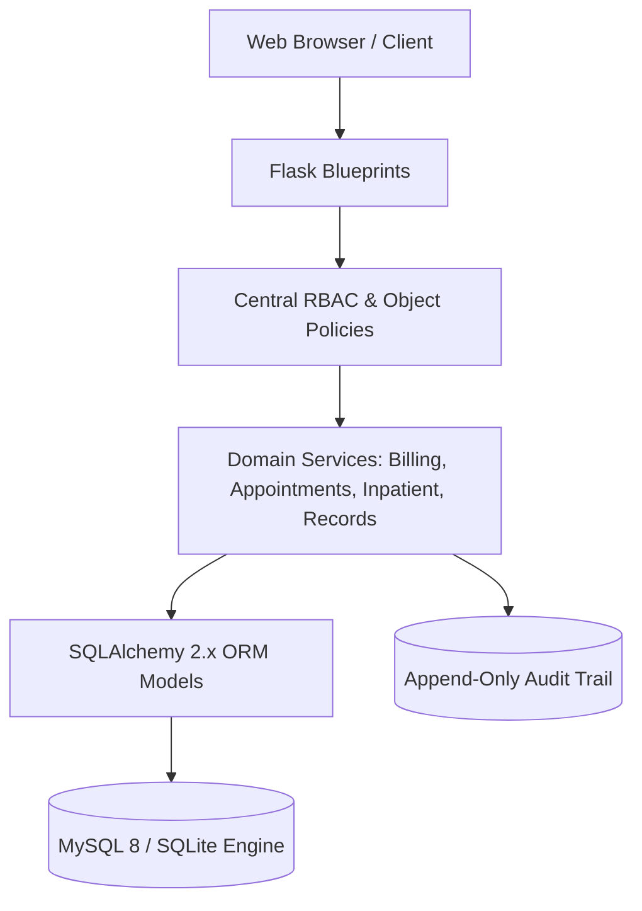

# Hospital OS — Modern Clinical & Hospital Information System

[](https://www.python.org/downloads/)
[](https://palletsprojects.com/p/flask/)
[](LICENSE)
[](requirements.txt)

Hospital OS is a role-aware Hospital Management System engineered with clinical safety, data integrity, and strict access control. Built with Python 3.12, Flask 3, and SQLAlchemy 2.

---

## Quickstart

### 1. Clone & Set Up Environment
```bash
git clone https://github.com/Mayur-cw/hospital-system-updated.git
cd hospital-system-updated
python3.12 -m venv .venv
source .venv/bin/activate
pip install -U pip
pip install -r requirements.txt
pip install -r requirements-dev.txt
```

### 2. Configure Environment
```bash
cp .env.example .env
```

### 3. Initialize Demo Data
```bash
flask --app PROJECT/app.py seed-demo
```
*(Randomized credentials will be generated and printed once in your terminal).*

### 4. Run Development Server
```bash
flask --app PROJECT/app.py run --port 5000
```

### 5. Run Test Suite
```bash
pytest -v
```

---

## System Architecture



---

## Roadmap & Tracking

Every planned upgrade, architectural decision, and bug remediation is tracked under [`CHANGES.md`](CHANGES.md).
