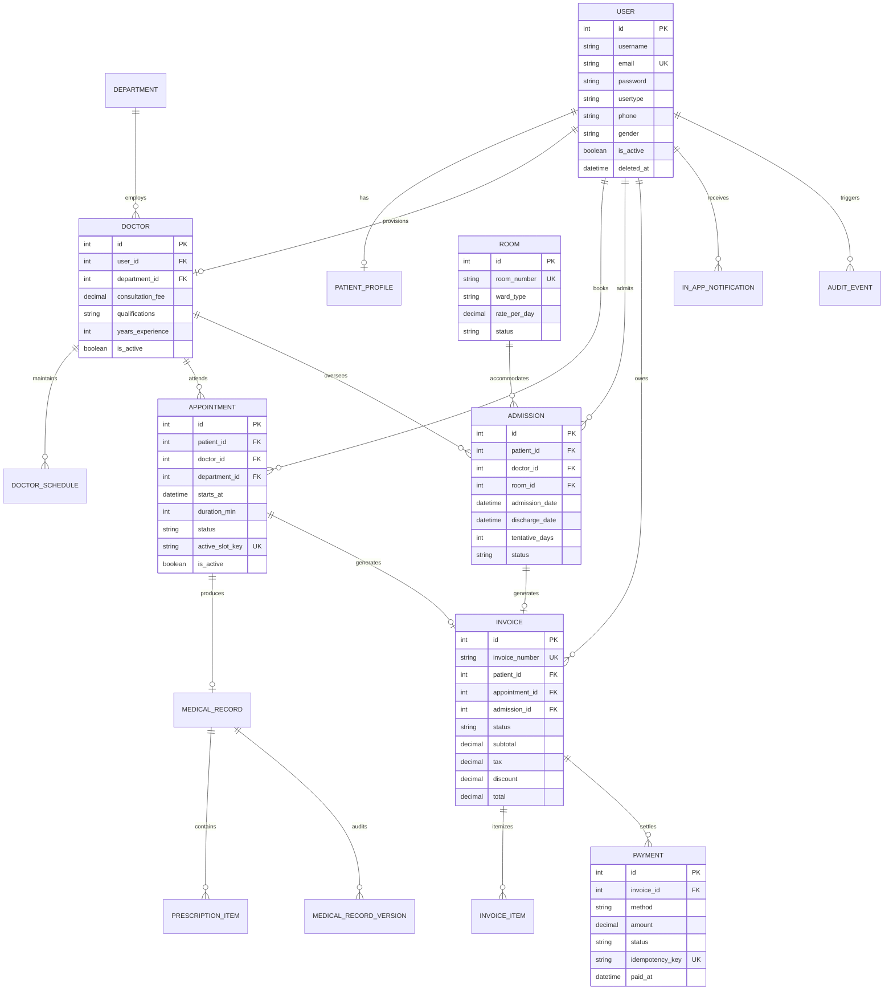

# Hedgewar Hospital Care — Hospital Management System (HMS)

[](https://www.python.org/downloads/)
[](https://palletsprojects.com/p/flask/)
[](https://www.sqlalchemy.org/)
[](https://www.mysql.com/)
[](LICENSE)
[](requirements.txt)
[](tools/check_contrast.py)
[](tests/)

**Hedgewar Hospital Care** is an enterprise-grade, role-aware Hospital Information & Clinical Management System designed for outpatient scheduling, inpatient bed management, electronic health records (EHR), versioned medical prescribing, and strict financial billing.

Built with **Python 3.12**, **Flask 3**, **SQLAlchemy 2.0**, and **MySQL 8.0**, the platform guarantees clinical safety, transactional integrity, and zero double-booking concurrency.

---

## 1. System Architecture

Hedgewar Hospital Care follows a clean Domain-Driven Design (DDD) layered architecture:

```mermaid
flowchart TD
    Client["Clients\n(Web Browser / Mobile / API)"]
    
    subgraph Edge["Security & Gateway Layer"]
        Proxy["Reverse Proxy / Nginx\n(TLS Termination, Static Assets)"]
        Talisman["Flask-Talisman\n(CSP, HSTS, X-Frame-Options)"]
        Limiter["Flask-Limiter\n(Redis-backed Rate Limiter)"]
        CSRF["Flask-WTF\n(Strict CSRF Protection)"]
    end

    subgraph App["Application Core (hms/)"]
        AppFactory["Application Factory\n(create_app)"]
        
        subgraph Presentation["Presentation & Routing"]
            MainRoutes["routes/main.py\n(Landing, Public Portal)"]
            AuthRoutes["routes/auth.py\n(Login, Signup, Reset)"]
            PatientRoutes["routes/patient.py\n(Booking, Records, Bills)"]
            DoctorRoutes["routes/doctor.py\n(Queue, Consult, Rx)"]
            AdminRoutes["routes/admin.py\n(Staff, Rooms, Settings)"]
            APIRoutes["routes/api.py\n(Slots, OpenAPI v1)"]
            HealthRoutes["routes/health.py\n(healthz, readyz)"]
        end

        subgraph Policies["Security & Authorization"]
            RBAC["hms/policies.py\n(roles_required, Deny-by-Default)"]
            Ownership["Object-Level Ownership\n(Attending Doctor, Invoice Owner)"]
        end

        subgraph DomainServices["Domain Service Layer (hms/services/)"]
            AccountSvc["AccountService"]
            ApptSvc["AppointmentService"]
            AvailSvc["AvailabilityService"]
            AdmissionSvc["AdmissionService"]
            BillingSvc["BillingService"]
            RecordSvc["RecordService"]
            NotifSvc["NotificationService"]
            AuditSvc["AuditService"]
            SearchSvc["SearchService"]
            GatewaySvc["PaymentGateway\n(Mock / Razorpay)"]
        end

        subgraph Persistence["Data & Model Layer (hms/models/)"]
            UserMod["User & PatientProfile"]
            DoctorMod["Doctor, Schedule, Leaves"]
            ApptMod["Appointment (ActiveSlotKey)"]
            AdmisMod["Admission & Room"]
            BillMod["Invoice, InvoiceItem, Payment"]
            RecMod["MedicalRecord & PrescriptionItem"]
            NotifMod["InAppNotification & Outbox"]
            AuditMod["AuditEvent"]
            SettingMod["HospitalSetting"]
        end
    end

    subgraph Storage["Infrastructure & Storage Layer"]
        MySQL[("MySQL 8.0+\n(Row Locks, InnoDB, Generated Cols)")]
        RedisCache[("Redis 7.0+\n(Rate Limiter State)")]
        SMTP["Mailpit / SMTP Relay\n(Notification Delivery)"]
    end

    Client --> Proxy
    Proxy --> Talisman
    Talisman --> Limiter
    Limiter --> CSRF
    CSRF --> AppFactory
    AppFactory --> Presentation
    Presentation --> Policies
    Policies --> DomainServices
    DomainServices --> Persistence
    Persistence --> MySQL
    Limiter -.-> RedisCache
    DomainServices -.-> SMTP
```



---

## 2. Relational Entity Architecture



---

## 3. Role-Based Feature Capabilities

| Feature / Capability | Patient | Doctor | Receptionist | Administrator |
|---|:---:|:---:|:---:|:---:|
| **Public Landing & Doctor Directory** | Yes | Yes | Yes | Yes |
| **Self-Service Registration & Password Reset** | Yes | — | — | — |
| **Appointment Booking & Slot Calendar** | Yes | — | On Behalf | On Behalf |
| **Appointment Reschedule & Cancellation** | Yes (Cutoff window) | — | Yes | Yes |
| **Inpatient Status & Bed Assignment Card** | View Own | Assigned Ward | All Beds | Full Board |
| **Clinical Consultation & Prescribing** | View Own Rx | Create / Amend | — | Audit View |
| **Prescription History & Printable Summary** | Yes | Yes | — | Yes |
| **Invoice Settlement (Online / UPI / Card)** | Yes | — | — | Yes |
| **Counter Cash Settlement & Receipting** | — | — | Yes | Yes |
| **Patient Queue & Attendance Check-In** | — | Own Queue | All OPD | All OPD |
| **Staff & Practitioner Account Provisioning** | — | — | — | Yes |
| **Room Maintenance & Ward Transfers** | — | — | — | Yes |
| **System Settings & Hospital Branding** | — | — | — | Yes |
| **CSV Analytical Data Exports** | — | — | — | Yes |
| **Append-Only Clinical Audit Trail** | — | — | — | Yes |

---

## 4. Quickstart Guide

### Option 1: Run with Docker Compose (Recommended)

Requires Docker 24+ and Docker Compose v2:

```bash
# 1. Clone the repository
git clone https://github.com/HedgewarHospital/hospital-management-system.git
cd hospital-management-system

# 2. Launch application, MySQL 8, Mailpit, and Redis
make up

# 3. Apply database migrations
make migrate

# 4. (Optional) Seed realistic 6-month demo dataset
make seed
```
- **Web Application:** [http://localhost:5000](http://localhost:5000)
- **Mailpit Email Portal:** [http://localhost:8025](http://localhost:8025)
- **Container Health Check:** [http://localhost:5000/healthz](http://localhost:5000/healthz)
- **OpenAPI Schema Documentation:** [http://localhost:5000/api/v1/openapi.json](http://localhost:5000/api/v1/openapi.json)

---

### Option 2: Local Virtual Environment Setup

Requires Python 3.12+ and a local MySQL 8.0+ instance:

```bash
# 1. Create and activate virtual environment
python3.12 -m venv .venv312
source .venv312/bin/activate

# 2. Install production and development dependencies
pip install -r requirements.txt -r requirements-dev.txt

# 3. Configure environment variables
cp .env.example .env
# Edit .env with your MySQL credentials

# 4. Apply schema migrations
flask db upgrade

# 5. Seed realistic 6-month simulation dataset
flask seed-demo --force

# 6. Start development server
flask run --port 5000
```

---

## 5. Automated Verification & Quality Gates

The repository is guarded by strict automated quality controls:

```bash
# Run complete test suite with coverage
make test

# Run Ruff linter and formatting check
make lint

# Run pip-audit for zero known vulnerabilities
make audit

# Run WCAG 2.2 AA color contrast audit (24 semantic pairs)
make contrast
```

### Verification Metrics
- **Tests Passing:** 110 / 110 passed across Unit, Concurrency, Authorization Matrix, Link Crawler, and E2E Journey.
- **Coverage:** $\ge 86\%$ across every domain service; $95\%$ on `hms/policies.py`.
- **Vulnerabilities:** Zero known vulnerabilities (`pip-audit` clean).
- **Accessibility:** 100% WCAG 2.2 AA compliant across all Light and Dark semantic token pairs.

---

## 6. Documentation Index

- [System Architecture](file:///Users/mayur/Sab_Kaam_ka/devlopment/my_projects/1.HMS/Hospital%20management%20system/docs/ARCHITECTURE.md) (`docs/ARCHITECTURE.md`)
- [Production Deployment Guide](file:///Users/mayur/Sab_Kaam_ka/devlopment/my_projects/1.HMS/Hospital%20management%20system/docs/DEPLOYMENT.md) (`docs/DEPLOYMENT.md`)
- [Security Architecture & Threat Model](file:///Users/mayur/Sab_Kaam_ka/devlopment/my_projects/1.HMS/Hospital%20management%20system/docs/security.md) (`docs/security.md`)
- [Billing & Room Rent Formulas](file:///Users/mayur/Sab_Kaam_ka/devlopment/my_projects/1.HMS/Hospital%20management%20system/docs/billing.md) (`docs/billing.md`)
- [Hospital Operations Analytics](file:///Users/mayur/Sab_Kaam_ka/devlopment/my_projects/1.HMS/Hospital%20management%20system/docs/analytics.md) (`docs/analytics.md`)
- [Disaster Recovery & Backup Runbook](file:///Users/mayur/Sab_Kaam_ka/devlopment/my_projects/1.HMS/Hospital%20management%20system/docs/backup_and_restore.md) (`docs/backup_and_restore.md`)
- [Architecture Decision Records (ADRs)](file:///Users/mayur/Sab_Kaam_ka/devlopment/my_projects/1.HMS/Hospital%20management%20system/docs/adr/) (`docs/adr/0001` through `0011`)
- [Contribution Guidelines](file:///Users/mayur/Sab_Kaam_ka/devlopment/my_projects/1.HMS/Hospital%20management%20system/CONTRIBUTING.md) (`CONTRIBUTING.md`)
- [Changelog](file:///Users/mayur/Sab_Kaam_ka/devlopment/my_projects/1.HMS/Hospital%20management%20system/CHANGELOG.md) (`CHANGELOG.md`)

---

## 7. License

Distributed under the MIT License. See [LICENSE](file:///Users/mayur/Sab_Kaam_ka/devlopment/my_projects/1.HMS/Hospital%20management%20system/LICENSE) for details.
