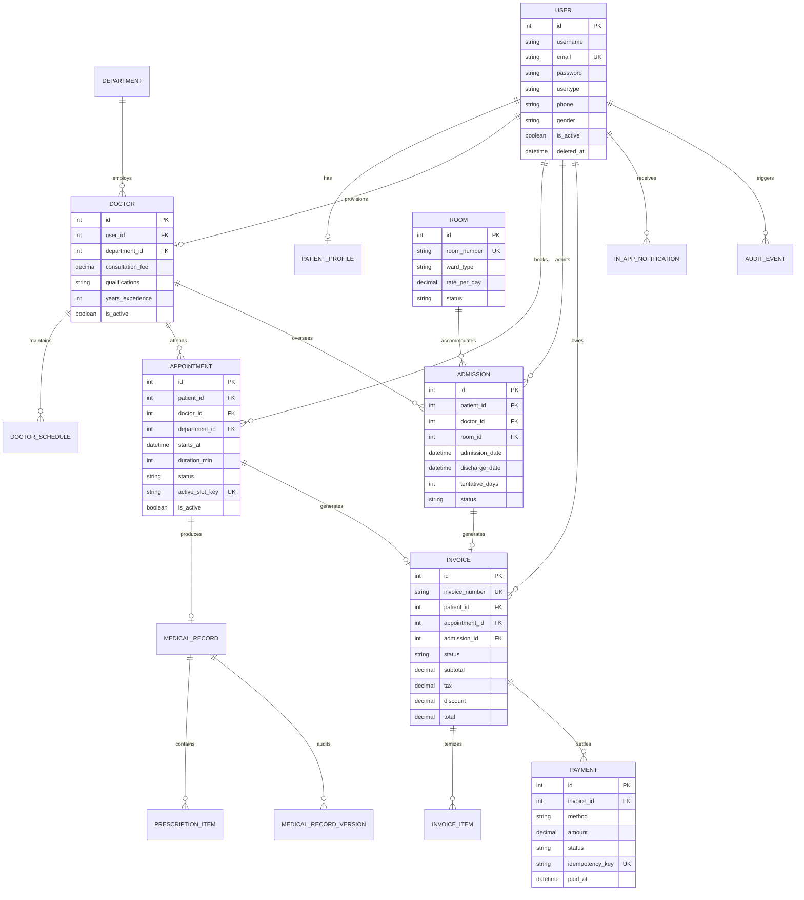

# System Architecture & Technical Specification

**Hedgewar Hospital Care — Enterprise Hospital Management System (HMS)**  
*Document Version: 1.0.0*

---

## 1. System Overview & Component Diagram

Hedgewar Hospital Care is built as a layered, modular Flask 3 application adhering to Domain-Driven Design (DDD) principles. The architecture isolates presentation, domain services, data persistence, and security into clear, decoupled boundaries.

```mermaid
flowchart TD
    Client["Clients\n(Web Browser / Mobile / API)"]
    
    subgraph Edge["Edge & Security Layer"]
        ReverseProxy["Reverse Proxy / Nginx\n(TLS Termination, Static Assets)"]
        Talisman["Flask-Talisman\n(CSP, HSTS, X-Frame-Options)"]
        Limiter["Flask-Limiter\n(Redis-backed Rate Limiter)"]
        CSRF["Flask-WTF\n(Strict CSRF Protection)"]
    end

    subgraph App["Application Core (hms/)"]
        AppFactory["Application Factory\n(create_app)"]
        
        subgraph Presentation["Presentation & Routing"]
            MainRoutes["routes/main.py\n(Landing, Public Portal)"]
            AuthRoutes["routes/auth.py\n(Login, Signup, Reset)"]
            PatientRoutes["routes/patient.py\n(Booking, Records, Bills)"]
            DoctorRoutes["routes/doctor.py\n(Queue, Consult, Rx)"]
            AdminRoutes["routes/admin.py\n(Staff, Rooms, Settings)"]
            APIRoutes["routes/api.py\n(Slots, OpenAPI v1)"]
            HealthRoutes["routes/health.py\n(healthz, readyz)"]
        end

        subgraph Policies["Security & Authorization"]
            RBAC["hms/policies.py\n(roles_required, Deny-by-Default)"]
            Ownership["Object-Level Ownership\n(Attending Doctor, Invoice Owner)"]
        end

        subgraph DomainServices["Domain Service Layer (hms/services/)"]
            AccountSvc["AccountService"]
            ApptSvc["AppointmentService"]
            AvailSvc["AvailabilityService"]
            AdmissionSvc["AdmissionService"]
            BillingSvc["BillingService"]
            RecordSvc["RecordService"]
            NotifSvc["NotificationService"]
            AuditSvc["AuditService"]
            SearchSvc["SearchService"]
            GatewaySvc["PaymentGateway\n(Mock / Razorpay)"]
        end

        subgraph Persistence["Data & Model Layer (hms/models/)"]
            UserMod["User & PatientProfile"]
            DoctorMod["Doctor, Schedule, Leaves"]
            ApptMod["Appointment (ActiveSlotKey)"]
            AdmisMod["Admission & Room"]
            BillMod["Invoice, InvoiceItem, Payment"]
            RecMod["MedicalRecord & PrescriptionItem"]
            NotifMod["InAppNotification & Outbox"]
            AuditMod["AuditEvent"]
            SettingMod["HospitalSetting"]
        end
    end

    subgraph Storage["Infrastructure & Storage Layer"]
        MySQL[("MySQL 8.0+\n(Row Locks, InnoDB, Generated Cols)")]
        RedisCache[("Redis 7.0+\n(Rate Limiter State)")]
        SMTP["Mailpit / SMTP Relay\n(Notification Delivery)"]
    end

    Client --> ReverseProxy
    ReverseProxy --> Talisman
    Talisman --> Limiter
    Limiter --> CSRF
    CSRF --> AppFactory
    AppFactory --> Presentation
    Presentation --> Policies
    Policies --> DomainServices
    DomainServices --> Persistence
    Persistence --> MySQL
    Limiter -.-> RedisCache
    DomainServices -.-> SMTP
```

---

## 2. Entity-Relationship (ER) Architecture

The physical relational schema enforces complete referential integrity, strict `DECIMAL(10, 2)` monetary columns, generated unique constraints, and soft deletion.

---

## 3. Key Architectural Decisions (ADRs Summary)

1. **ADR 0001 (D-01): Typed DateTime Timestamps**
   Replaced error-prone separate `VARCHAR` date and string times with standard `DATETIME` (`starts_at`) indexed for chronological range queries.
2. **ADR 0002 (D-02): Single Status Vocabulary**
   Unified all status values into database-level enums (`Scheduled`, `CheckedIn`, `Completed`, `Cancelled`, `Missed`).
3. **ADR 0003 (D-03): Database-Enforced Double-Booking Prevention**
   Utilizes a MySQL stored generated column `active_slot_key` evaluated as `CASE WHEN status IN ('Cancelled', 'Missed') THEN NULL ELSE CONCAT(doctor_id, '|', DATE_FORMAT(starts_at, '%Y-%m-%d %H:%i')) END` backed by a unique index. Cancelled appointments naturally free the slot without race conditions.
4. **ADR 0004 (D-04): Strict Decimal Monetary Calculations**
   Banned all floating-point variables for currency. Financial computations use Python's `Decimal` mapped to `DECIMAL(10, 2)`.
5. **ADR 0005 (D-05): Soft Deletes & Referential Integrity**
   Entities with clinical or financial history are soft-deleted via `is_active` and `deleted_at`. Hard foreign key cascades are blocked (`ON DELETE RESTRICT`).
6. **ADR 0006 (D-06): Inpatient Admission Lifecycle & Daily Rate Accrual**
   Admissions track bed allocation, doctor discharge recommendations, automated 24-hour block billing calculation, and bed release upon invoice settlement.
7. **ADR 0007 (D-07): Versioned Clinical Records & Amendments**
   Medical records maintain historical amendment versions (`MedicalRecordVersion`) preserving non-repudiation and clinical history.
8. **ADR 0008 (D-08): Transactional Outbox Pattern**
   Outbound communications are written to `notification_outbox` within the same database transaction as the business event, guaranteeing zero dropped notifications.
9. **ADR 0009 (D-09): Central Object-Level RBAC**
   All authorization logic resides in `hms/policies.py` implementing deny-by-default access control for all four roles.
10. **ADR 0010 (D-10): Zero-PHI Structured JSON Logging**
    Single-line JSON logs correlate requests via `X-Request-ID` and redact patient identifiable data, symptoms, and credentials.
11. **ADR 0011 (D-11): Composite Indexing & Performance Budget**
    Composite indexes (`ix_patient_starts_at`, `ix_doctor_starts_at`) and eager query loading eliminate N+1 regressions and bound dashboard query counts to $\le 10$.
