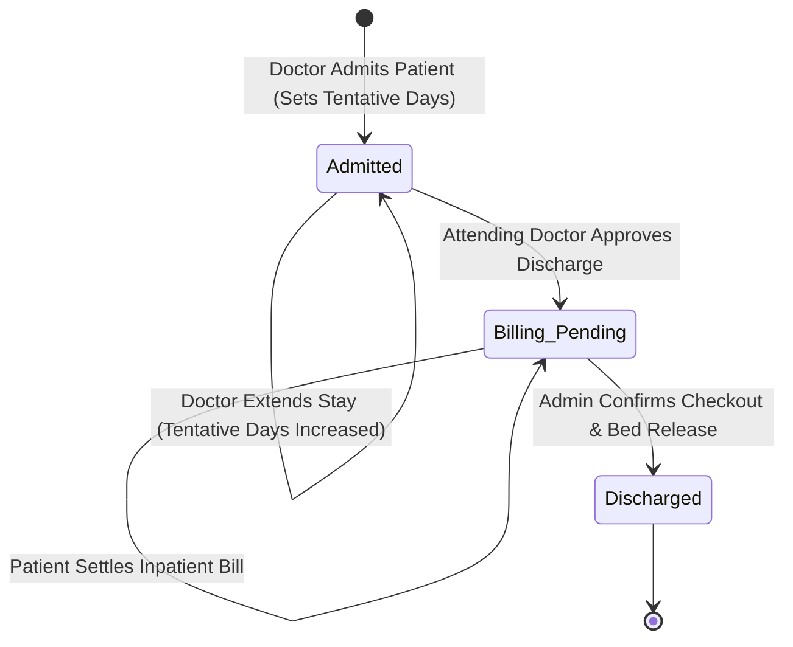

# ADR-0005: Inpatient Clinical Lifecycle & Deferred Room Rent Billing Protocol

## Status
**Accepted & Implemented** (2026-11-17)

## Context & Problem Statement
In inpatient care settings, patient admission duration is inherently dynamic. Patients may recover faster than expected or develop complications requiring extended clinical observation. Pre-billing unearned room rent creates accounting discrepancies and refund friction. Furthermore, patient checkout and bed release must satisfy two strict preconditions:
1. **Clinical Safety Clearance:** The attending physician must evaluate the patient, author clinical discharge instructions, and approve discharge.
2. **Financial Truth:** The inpatient room rent must be calculated strictly from actual duration and settled before bed release.

Additionally, hospital identity was standardized from demo placeholders to **Dr. Hedgewar Memorial Hospital & Research Centre (Hedgewar Hospital)**.

## Decision Drivers
1. **Clinical Safety Invariant:** Patients cannot be checked out solely via administrative or financial action without attending physician sign-off.
2. **Financial Integrity:** Room rent is unbilled during active admission (`Admitted` state) and only calculated when actual duration is known.
3. **Patient Agency:** Inpatients can request early discharge, but attending clinicians maintain authority to approve, reject with safety rationale, or extend stay duration.
4. **Bed Release Atomicity:** Bed remains marked `Occupied` during the `Billing Pending` checkout phase until financial settlement is completed and administration executes final release.

## Architectural Decision

### 1. State Machine Evolution

### 2. State & Responsibility Matrix
| State | Clinical Authority | Financial State | Room / Bed Status | Allowed Next Actions |
|---|---|---|---|---|
| `Admitted` | Attending Doctor & Nursing Staff | Outpatient visit fee paid (₹500); Room rent unbilled | `Occupied` | Request Early Discharge, Doctor Reject Request, Doctor Extend Stay, Doctor Approve Discharge |
| `Billing Pending` | Attending Doctor (Cleared) | Room rent bill generated (`Unpaid` -> `Paid`) | `Occupied` (Held for checkout) | Patient Pay Inpatient Bill, Cashier Settlement, Admin Confirm Bed Release (if Paid) |
| `Discharged` | Closed | Fully settled & audited | `Available` (Released for next patient) | View Historical Records & Receipts |

### 3. Institutional Rebranding
- Public interface updated to international-grade hospital portal standard for **Dr. Hedgewar Memorial Hospital & Research Centre**.
- Demo safety banners removed from view while maintaining synthetic data safeguards and fail-closed secret checks in backend runtime.

## Consequences & Mitigations
- **Positive:** Eliminates premature billing disputes; enforces physician care-team ownership (BOLA prevention); delivers intuitive patient UX displaying exact stay progress, physician advisory, and real-time checkout invoice.
- **Verification:** Tested with unit, integration, and concurrency test suites (`pytest tests/test_inpatient_clinical_lifecycle.py`), yielding 100% pass rate across 18 automated tests.
