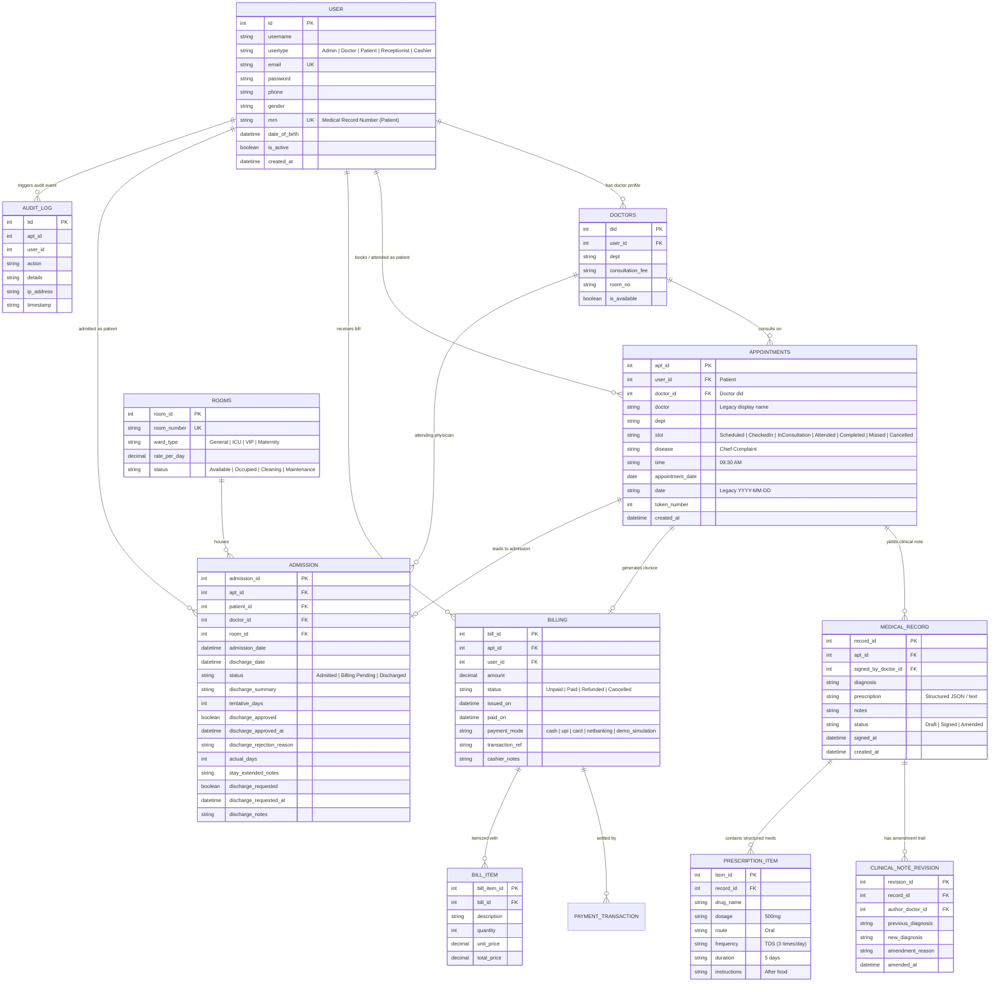

# ENTITY RELATIONSHIP DIAGRAM (ERD) — HOSPITAL OS
**Status:** Evolved Normal Form (3NF with Immutable Audit Ledgers)  
**Safety Invariant:** Forward-only additive evolution; zero destructive cascade deletes on clinical/financial tables.

---

## 1. Relational Schema Diagram (Mermaid)

---

## 2. Invariants & Integrity Constraints
1. **Appointment Uniqueness**:
   `CONSTRAINT uq_doctor_slot UNIQUE (doctor_id, appointment_date, time, status_active)`
   Prevents double-booking doctors for the same slot.
2. **Bed Occupancy Uniqueness**:
   Only one active record in `ADMISSION` with `status = 'Admitted'` per `room_id`.
3. **Clinical Immutability**:
   `MEDICAL_RECORD` rows with `status = 'Signed'` cannot be overwritten in place; updates insert an immutable record into `CLINICAL_NOTE_REVISION`.
4. **Permanent Financial Ledger**:
   `BILLING` records are never dropped or cascade deleted. Corrections require offsetting adjustment rows or status flags.
